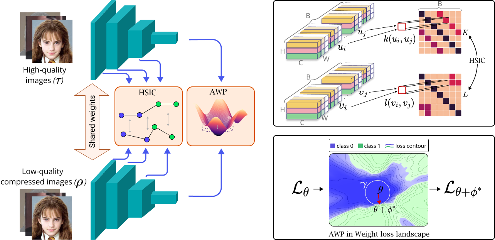

# QAD: Quality-Agnostic Deepfake Detection with Intra-model Collaborative Learning 

UNDER REVIEW - ID 5523<br /> 
*2023 International Conference on Computer Vision* <br /> 


## Overview of our framework



## Installation
- Ubuntu 18.04.5 LTS
- CUDA 10.2
- Python 3.6.10

## Datasets 
* NeuralTextures [[Dataset]](https://github.com/ondyari/FaceForensics) [[Paper]](https://arxiv.org/abs/1904.12356) 
* DeepFakes [[Dataset]](https://github.com/ondyari/FaceForensics)  [[GitHub]](https://github.com/deepfakes/faceswap)
* Face2Face [[Dataset]](https://github.com/ondyari/FaceForensics) [[Paper]](https://arxiv.org/abs/2007.14808)
* FaceSwap [[Dataset]](https://github.com/ondyari/FaceForensics) [[GitHub]](https://github.com/deepfakes/faceswap)
* FaceShifter [[Dataset]](https://github.com/ondyari/FaceForensics)  [[Paper]](https://arxiv.org/abs/1912.13457) 
* CelebDFv2 [[Dataset]](https://cse.buffalo.edu/~siweilyu/celeb-deepfakeforensics.html)  [[Paper]](https://arxiv.org/abs/1909.12962) 
* FFIW10K [[Dataset]](https://github.com/tfzhou/FFIW)  [[Paper]](https://arxiv.org/abs/2103.04570) 
```
python train --config ./configs/hkrawp.yaml
```